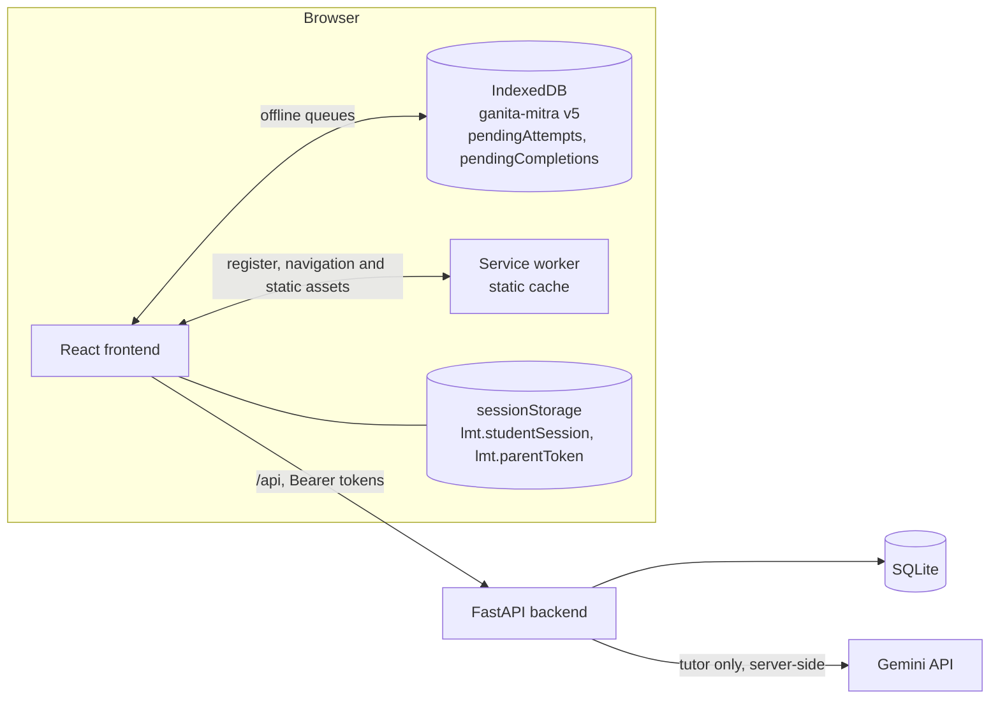

# Architecture

## System Overview

Notes on the diagram:

- The service worker caches static files only. Requests to `/api` are never cached or intercepted.
- The Gemini API key is used only by the FastAPI backend. The browser never calls Gemini directly.

## Frontend

- React + Vite single-page app, served as a PWA.
- Lessons and chapter data are available offline after the first load.
- Practice attempts and lesson completions made offline are written to IndexedDB first, then synced.

## Authentication

### Student auth

- A student logs in with a PIN. The backend verifies the PIN and returns an 8-hour HMAC-signed token.
- The token is kept in `sessionStorage` under the key `lmt.studentSession`.

### Parent auth

- Parent setup happens once. The request to `POST /api/parents/setup` must include the `X-Setup-Token` header, which must match `PARENT_SETUP_TOKEN` on the server.
- Parent login returns a parent token. It is kept in `sessionStorage` under the key `lmt.parentToken`.

### Role separation

- A student token used on parent routes is rejected with **401**. A parent token used where a student is required is rejected with **403**, so roles cannot be mixed.

## Student Isolation

- Progress and sync routes check the token subject against the requested profile id. A student can only read or write their own profile data.
- Parent and student access are separated by role checks as described above.

## Practice Answer Checking

- The backend is authoritative: it decides whether an answer is correct.
- While offline, the answer is saved to the `pendingAttempts` queue. The UI does not mark it correct or incorrect until the server responds.

## AI Tutor Flow

- The frontend blocks tutor requests while the browser is offline.
- The backend calls Gemini server-side. It applies an in-memory rate limit of 20 requests per 60 seconds per student.
- Tutor error responses: **404**, **429** (rate limit), **502**, and **503** (the README notes that a missing `GEMINI_API_KEY` or `MODEL_NAME` returns 503). See [API](API.md) for the exact conditions.

## Offline Storage and Sync

- IndexedDB database `ganita-mitra`, version 5, with stores `pendingAttempts` and `pendingCompletions`.
- Each queue item is retried up to **8 tries**. After that it is given up and marked with `lastError` set to `GAVE_UP`.
- Sync is triggered by:
  - the browser `online` event,
  - app startup,
  - entering a student profile,
  - a retry timer,
  - a manual click on the `SyncIndicator`.

### Duplicate Prevention

- Every attempt carries a UUID. The server dedupes on this UUID, so a retried attempt is not recorded twice.

## Service Worker

- Precache list: `/`, `/index.html`, the web manifest, the app icon, and `/data/chapter.json`.
- Navigation requests use **network-first**.
- Static assets use **cache-first**.
- `/api` requests are never intercepted.
- The new worker waits until it receives a `SKIP_WAITING` message.
- On activate, the worker calls `clients.claim()`.

## Database (SQLite)

Tables:

- `students`
- `questions`
- `attempts`
- `lesson_progress`
- `tutor_messages`
- `parent_config`

Related: [API](API.md), [Offline and PWA](OFFLINE_AND_PWA.md), [Security and Privacy](SECURITY_AND_PRIVACY.md), [Testing](TESTING.md).
